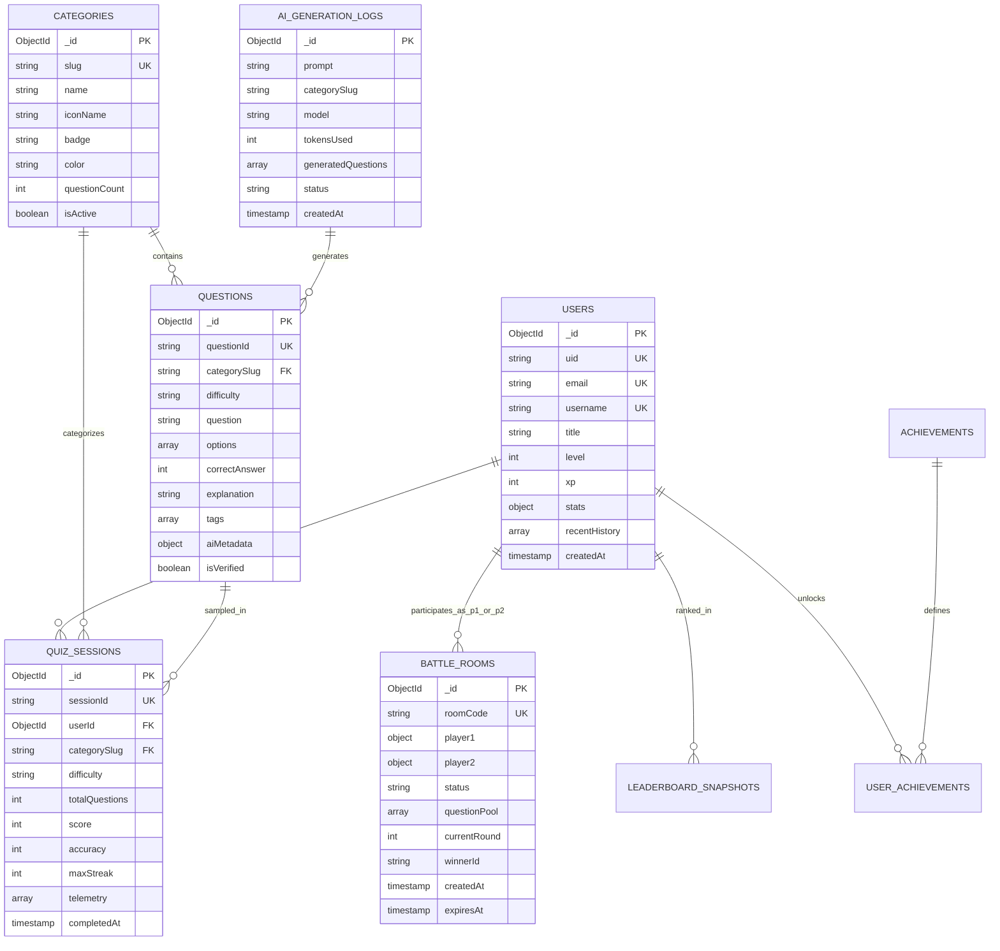

# MongoDB Database Architecture & Design System
### AI QUIZ BATTLE — High-Performance Distributed Data Architecture

---

## 1. Executive Summary & Design Philosophy

The **AI QUIZ BATTLE** data layer is engineered for ultra-low latency (<10ms document lookups), real-time multiplayer telemetry, AI-generated content streaming, and massive analytical aggregation capability (leaderboards, accuracy heatmaps, XP curves). 

MongoDB was selected as the primary document database due to:
- **Polymorphic Content Structure**: Quiz questions span multiple domains (code snippets, multi-choice, true/false, AI-generated reasoning explanations).
- **High-Velocity Real-time Telemetry**: Real-time 1v1 battle rooms and session streams require high-throughput atomic updates without locking table rows.
- **Embedded Document Performance**: Denormalizing recent history, telemetry stats, and player badges inside user profiles eliminates costly multi-table SQL joins on high-traffic screen renders.
- **Geographic & Scalable Sharding**: Seamless horizontal partitioning by `userId` or `categoryId` as the pilot base scales globally.

---

## 2. Global Database Architecture & Topology

```
                              ┌───────────────────────────┐
                              │  Client Applications      │
                              │  (React + Vite Web App)   │
                              └─────────────┬─────────────┘
                                            │ HTTPS / WSS
                                            ▼
                              ┌───────────────────────────┐
                              │  Backend API Gateway      │
                              │  (FastAPI / Node.js)      │
                              └─────────────┬─────────────┘
                                            │ Connection Pool (100 max)
                                            ▼
                    ┌───────────────────────────────────────────────┐
                    │      MongoDB Atlas / Replica Set (Primary)    │
                    │      Database: `ai_quiz_battle`               │
                    └───────┬───────────────────────────────┬───────┘
                            │                               │
                ┌───────────▼───────────┐       ┌───────────▼───────────┐
                │ Secondary Node (Read) │       │ Secondary Node (Read) │
                │ Leaderboard & Reports │       │ Analytical Samplers   │
                └───────────────────────┘       └───────────────────────┘
```

### 2.1 Database & Connection Specifications
- **Database Name**: `ai_quiz_battle`
- **Environment Names**: `ai_quiz_battle_dev`, `ai_quiz_battle_staging`, `ai_quiz_battle_prod`
- **Driver**: `Motor / Beanie` (Python FastAPI) or `Mongoose v8+` (Node.js/TypeScript)
- **Connection String Pattern**: `mongodb+srv://<username>:<password>@cluster0.ai-battle.mongodb.net/ai_quiz_battle?retryWrites=true&w=majority&maxPoolSize=100&minPoolSize=10`
- **Read Preference**: `primaryPreferred` for gameplay, `secondaryPreferred` for leaderboard queries and analytics.
- **Write Concern**: `w: "majority"`, `j: true` for purchases and profile level-ups; `w: 1` for ephemeral telemetry clicks.

---

## 3. Comprehensive Entity-Relationship Overview



---

## 4. Detailed Collection Specifications & JSON Schemas

### 4.1 Collection: `users`
Represents the pilot player profile, authentication identity, real-time level telemetry, denormalized performance stats, and equipped cosmetic items.

#### Document Schema (BSON / JSON)
```json
{
  "_id": { "$oid": "66d1a2b3c4e5f67890123450" },
  "uid": "firebase_auth_uid_987654321",
  "email": "pilot@quizbattle.ai",
  "username": "CyberHunter",
  "title": "Quiz Gladiator",
  "avatar": "https://images.unsplash.com/photo-1535713875002-d1d0cf377fde?auto=format&fit=crop&q=80&w=120",
  "role": "pilot",
  "level": 12,
  "xp": 3450,
  "nextLevelXp": 5000,
  "stats": {
    "totalQuizzes": 14,
    "totalScore": 9800,
    "bestScore": 980,
    "bestStreak": 6,
    "accuracy": 82.4,
    "battlesWon": 9,
    "battlesLost": 3,
    "categoryBreakdown": {
      "python": { "quizzes": 5, "accuracy": 88.5, "highScore": 980 },
      "ai_ml": { "quizzes": 4, "accuracy": 80.0, "highScore": 920 },
      "javascript": { "quizzes": 3, "accuracy": 78.0, "highScore": 750 }
    }
  },
  "recentHistory": [
    {
      "sessionId": "sess_894321",
      "categorySlug": "ai_ml",
      "categoryName": "AI & Machine Learning",
      "difficulty": "medium",
      "score": 980,
      "accuracy": 80,
      "streak": 6,
      "completedAt": { "$date": "2026-08-31T01:30:00.000Z" }
    }
  ],
  "unlockedAchievements": ["first_blood", "streak_master_5", "speed_demon"],
  "settings": {
    "soundEnabled": true,
    "hapticFeedback": true,
    "theme": "lamborghini_dark"
  },
  "isBanned": false,
  "lastActiveAt": { "$date": "2026-08-31T03:15:00.000Z" },
  "createdAt": { "$date": "2026-08-01T12:00:00.000Z" },
  "updatedAt": { "$date": "2026-08-31T03:15:00.000Z" }
}
```

#### MongoDB Validator (`$jsonSchema`)
```javascript
db.createCollection("users", {
  validator: {
    $jsonSchema: {
      bsonType: "object",
      required: ["uid", "email", "username", "level", "xp", "stats", "createdAt"],
      properties: {
        uid: { bsonType: "string", description: "Unique auth provider ID" },
        email: { bsonType: "string", pattern: "^.+@.+$", description: "Valid email address" },
        username: { bsonType: "string", minLength: 3, maxLength: 30, description: "Display handle" },
        title: { bsonType: "string", description: "Rank title (e.g. Quiz Gladiator)" },
        avatar: { bsonType: "string" },
        role: { enum: ["pilot", "moderator", "admin"], description: "Access level" },
        level: { bsonType: "int", minimum: 1 },
        xp: { bsonType: "int", minimum: 0 },
        nextLevelXp: { bsonType: "int", minimum: 1 },
        stats: {
          bsonType: "object",
          required: ["totalQuizzes", "totalScore", "bestScore", "accuracy"],
          properties: {
            totalQuizzes: { bsonType: "int", minimum: 0 },
            totalScore: { bsonType: "int", minimum: 0 },
            bestScore: { bsonType: "int", minimum: 0 },
            bestStreak: { bsonType: "int", minimum: 0 },
            accuracy: { bsonType: ["double", "int"], minimum: 0, maximum: 100 }
          }
        },
        recentHistory: {
          bsonType: "array",
          items: {
            bsonType: "object",
            required: ["sessionId", "categorySlug", "score", "accuracy", "completedAt"]
          }
        },
        createdAt: { bsonType: "date" },
        updatedAt: { bsonType: "date" }
      }
    }
  }
});
```

---

### 4.2 Collection: `categories`
Stores knowledge domains, UI presentation tokens (gradients, glows, icons), and aggregated question statistics.

#### Document Schema (BSON / JSON)
```json
{
  "_id": { "$oid": "66d1a2b3c4e5f67890123461" },
  "slug": "python",
  "name": "Python",
  "iconName": "Code",
  "description": "Master Python syntax, data structures, OOP concepts, and standard library.",
  "badge": "Popular",
  "color": "from-blue-500 to-cyan-400",
  "borderColor": "hover:border-cyan-500/50",
  "accentGlow": "rgba(6, 182, 212, 0.25)",
  "questionCount": 150,
  "difficultyStats": {
    "easy": 50,
    "medium": 65,
    "hard": 35
  },
  "displayOrder": 1,
  "isActive": true,
  "createdAt": { "$date": "2026-01-01T00:00:00.000Z" },
  "updatedAt": { "$date": "2026-08-31T00:00:00.000Z" }
}
```

---

### 4.3 Collection: `questions`
Represents the atomic question bank with multi-difficulty tagging, verified status, markdown/code block support, and AI generation lineage.

#### Document Schema (BSON / JSON)
```json
{
  "_id": { "$oid": "66d1a2b3c4e5f67890123472" },
  "questionId": "py-6",
  "categorySlug": "python",
  "difficulty": "hard",
  "question": "What does the `__slots__` attribute in a Python class accomplish?",
  "codeSnippet": "class Pilot:\n    __slots__ = ['callsign', 'rating']\n    def __init__(self, c, r):\n        self.callsign = c\n        self.rating = r",
  "options": [
    "It restricts inheritance from parent classes.",
    "It explicitly defines allowed instance attributes to save memory by preventing __dict__ creation.",
    "It automatically generates getter and setter methods for instance variables.",
    "It marks class methods as thread-safe synchronized functions."
  ],
  "correctAnswer": 1,
  "explanation": "Using `__slots__` prevents the automatic creation of instance `__dict__` and `__weakref__`, saving significant memory overhead per instance.",
  "points": 100,
  "timeLimitSeconds": 15,
  "tags": ["oop", "memory-optimization", "internals", "cpython"],
  "aiMetadata": {
    "isAiGenerated": true,
    "model": "gemini-1.5-pro",
    "promptVersion": "v2.4",
    "generatedAt": { "$date": "2026-08-20T10:00:00.000Z" }
  },
  "metrics": {
    "timesAnswered": 1420,
    "timesCorrect": 752,
    "averageTimeSeconds": 8.4
  },
  "isVerified": true,
  "verifiedBy": "admin_chief_curator",
  "isActive": true,
  "createdAt": { "$date": "2026-08-20T10:00:00.000Z" }
}
```

---

### 4.4 Collection: `quiz_sessions`
Captures granular telemetry of single-player or multiplayer match runs. Enables cheat detection, accuracy analytics, and historical audits.

#### Document Schema (BSON / JSON)
```json
{
  "_id": { "$oid": "66d1a2b3c4e5f67890123483" },
  "sessionId": "sess_894321_1725062400",
  "userId": { "$oid": "66d1a2b3c4e5f67890123450" },
  "userDisplayName": "CyberHunter",
  "categorySlug": "python",
  "difficulty": "hard",
  "stageCount": 10,
  "score": 850,
  "accuracy": 80,
  "maxStreak": 4,
  "timeSpentSeconds": 68.5,
  "telemetry": [
    {
      "questionId": "py-1",
      "selectedOption": 2,
      "correctAnswer": 2,
      "isCorrect": true,
      "timeTakenSeconds": 3.2,
      "scoreGained": 100,
      "streakAtMoment": 1
    },
    {
      "questionId": "py-6",
      "selectedOption": 1,
      "correctAnswer": 1,
      "isCorrect": true,
      "timeTakenSeconds": 6.8,
      "scoreGained": 120,
      "streakAtMoment": 2
    }
  ],
  "performanceBadge": "HYPER DRIVE",
  "performanceMessage": "EXCEPTIONAL TELEMETRY",
  "status": "completed",
  "completedAt": { "$date": "2026-08-31T01:30:00.000Z" }
}
```

---

### 4.5 Collection: `battle_rooms` (Multiplayer 1v1 PvP Arena)
Powers real-time synchronization between two gladiators over WebSockets. Leverages MongoDB TTL index to auto-evaporate abandoned rooms.

#### Document Schema (BSON / JSON)
```json
{
  "_id": { "$oid": "66d1a2b3c4e5f67890123494" },
  "roomCode": "ARENA-7749",
  "categorySlug": "ai_ml",
  "difficulty": "hard",
  "status": "in_progress", // "waiting", "in_progress", "completed", "abandoned"
  "player1": {
    "userId": { "$oid": "66d1a2b3c4e5f67890123450" },
    "username": "CyberHunter",
    "avatar": "https://images.unsplash.com/photo-1535713875002-d1d0cf377fde?auto=format&fit=crop&q=80&w=120",
    "currentQuestionIndex": 4,
    "score": 420,
    "streak": 3,
    "isReady": true
  },
  "player2": {
    "userId": { "$oid": "66d1a2b3c4e5f67890123451" },
    "username": "AlexRivera",
    "avatar": "https://images.unsplash.com/photo-1534528741775-53994a69daeb?auto=format&fit=crop&q=80&w=120",
    "currentQuestionIndex": 4,
    "score": 390,
    "streak": 1,
    "isReady": true
  },
  "questionPool": [
    { "$oid": "66d1a2b3c4e5f67890123472" },
    { "$oid": "66d1a2b3c4e5f67890123473" },
    { "$oid": "66d1a2b3c4e5f67890123474" },
    { "$oid": "66d1a2b3c4e5f67890123475" },
    { "$oid": "66d1a2b3c4e5f67890123476" }
  ],
  "currentRound": 4,
  "winnerId": null,
  "createdAt": { "$date": "2026-08-31T03:20:00.000Z" },
  "expiresAt": { "$date": "2026-08-31T03:50:00.000Z" } // TTL 30 minutes
}
```

---

### 4.6 Collection: `leaderboard_snapshots`
Pre-aggregated bucket rankings refreshed every 60 seconds or computed via MongoDB Window Functions to avoid full table scans on high concurrent leaderboard visits.

#### Document Schema (BSON / JSON)
```json
{
  "_id": { "$oid": "66d1a2b3c4e5f678901234a5" },
  "scope": "global", // "global", "category_python", "category_ai_ml", "weekly"
  "timeframe": "all_time", // "all_time", "weekly", "daily"
  "rankings": [
    {
      "rank": 1,
      "userId": { "$oid": "66d1a2b3c4e5f67890123451" },
      "name": "Alex Rivera",
      "avatar": "https://images.unsplash.com/photo-1534528741775-53994a69daeb?auto=format&fit=crop&q=80&w=120",
      "score": 1450,
      "accuracy": "94%",
      "category": "Python",
      "difficulty": "Hard",
      "badgeColor": "bg-amber-500/20 text-amber-300 border-amber-500/40",
      "streak": 12
    },
    {
      "rank": 2,
      "userId": { "$oid": "66d1a2b3c4e5f67890123452" },
      "name": "Rahul Sharma",
      "avatar": "https://images.unsplash.com/photo-1507003211169-0a1dd7228f2d?auto=format&fit=crop&q=80&w=120",
      "score": 1380,
      "accuracy": "91%",
      "category": "AI & Machine Learning",
      "difficulty": "Hard",
      "badgeColor": "bg-slate-300/20 text-slate-200 border-slate-300/40",
      "streak": 10
    }
  ],
  "lastGeneratedAt": { "$date": "2026-08-31T03:30:00.000Z" }
}
```

---

### 4.7 Collection: `ai_generation_logs`
Monitors AI LLM prompt generation, tokens consumed, hallucination filters, and QA review pipelines.

#### Document Schema (BSON / JSON)
```json
{
  "_id": { "$oid": "66d1a2b3c4e5f678901234b6" },
  "prompt": "Generate 10 advanced questions on Quantum Machine Learning and Qiskit with explanations.",
  "categorySlug": "ai_ml",
  "difficulty": "hard",
  "model": "gemini-1.5-pro",
  "tokensPrompt": 180,
  "tokensCompletion": 890,
  "totalCostUsd": 0.0042,
  "generatedQuestionCount": 10,
  "validationStatus": "approved", // "pending", "approved", "rejected"
  "rejectionReason": null,
  "createdAt": { "$date": "2026-08-31T02:00:00.000Z" }
}
```

---

## 5. Indexing Architecture & Performance Tuning

Indexes are designed following the **ESR Rule (Equality, Sort, Range)** for sub-millisecond execution.

| Collection | Index Keys | Type / Options | Target Query / Purpose |
|---|---|---|---|
| `users` | `{ "uid": 1 }` | **Unique** | Fast auth lookup on login |
| `users` | `{ "email": 1 }` | **Unique** | Prevent duplicate registrations |
| `users` | `{ "username": 1 }` | **Unique** | Profile slug & uniqueness |
| `users` | `{ "stats.totalScore": -1, "stats.accuracy": -1 }` | Compound (Desc) | Real-time global player rank determination |
| `questions` | `{ "categorySlug": 1, "difficulty": 1, "isActive": 1 }` | Compound | Fast random question sampler for game setup |
| `questions` | `{ "questionId": 1 }` | **Unique** | Direct question resolution |
| `questions` | `{ "question": "text", "tags": "text" }` | **Full-Text Index** | Keyword search across question bank |
| `categories` | `{ "slug": 1 }` | **Unique** | Category retrieval by URI parameter |
| `categories` | `{ "displayOrder": 1, "isActive": 1 }` | Compound | Ordered frontend grid rendering |
| `quiz_sessions` | `{ "userId": 1, "completedAt": -1 }` | Compound | User profile match history pagination |
| `quiz_sessions` | `{ "categorySlug": 1, "score": -1 }` | Compound | Category leaderboards |
| `battle_rooms` | `{ "roomCode": 1 }` | **Unique** | Matchmaking lobby joining |
| `battle_rooms` | `{ "expiresAt": 1 }` | **TTL Index** (`expireAfterSeconds: 0`) | Auto-evaporation of stale rooms |

### Index Creation Script (mongosh)
```javascript
// Execute on database `ai_quiz_battle`
use ai_quiz_battle;

// 1. Users
db.users.createIndex({ "uid": 1 }, { unique: true, name: "idx_users_uid_unique" });
db.users.createIndex({ "email": 1 }, { unique: true, name: "idx_users_email_unique" });
db.users.createIndex({ "username": 1 }, { unique: true, name: "idx_users_username_unique" });
db.users.createIndex({ "stats.totalScore": -1, "stats.accuracy": -1 }, { name: "idx_users_rank_score" });

// 2. Categories
db.categories.createIndex({ "slug": 1 }, { unique: true, name: "idx_categories_slug_unique" });
db.categories.createIndex({ "displayOrder": 1, "isActive": 1 }, { name: "idx_categories_active_order" });

// 3. Questions
db.questions.createIndex({ "questionId": 1 }, { unique: true, name: "idx_questions_id_unique" });
db.questions.createIndex({ "categorySlug": 1, "difficulty": 1, "isActive": 1 }, { name: "idx_questions_filter" });
db.questions.createIndex({ "question": "text", "tags": "text" }, { name: "idx_questions_text_search" });

// 4. Quiz Sessions
db.quiz_sessions.createIndex({ "sessionId": 1 }, { unique: true, name: "idx_sessions_id_unique" });
db.quiz_sessions.createIndex({ "userId": 1, "completedAt": -1 }, { name: "idx_sessions_user_history" });
db.quiz_sessions.createIndex({ "categorySlug": 1, "score": -1 }, { name: "idx_sessions_category_leaderboard" });

// 5. Battle Rooms (with TTL)
db.battle_rooms.createIndex({ "roomCode": 1 }, { unique: true, name: "idx_battle_room_code" });
db.battle_rooms.createIndex({ "expiresAt": 1 }, { expireAfterSeconds: 0, name: "idx_battle_room_ttl" });
```

---

## 6. High-Performance Aggregation Pipelines

### 6.1 Random Weighted Question Sampler
Fetches $N$ non-repeating questions for a given category and difficulty with an efficient `$sample` stage.

```javascript
db.questions.aggregate([
  {
    $match: {
      categorySlug: "python",
      difficulty: "medium",
      isActive: true,
      isVerified: true
    }
  },
  { $sample: { size: 10 } },
  {
    $project: {
      _id: 1,
      id: "$questionId",
      categoryId: "$categorySlug",
      question: 1,
      codeSnippet: 1,
      options: 1,
      correctAnswer: 1,
      difficulty: 1,
      explanation: 1,
      timeLimitSeconds: 1
    }
  }
]);
```

---

### 6.2 Real-time Global Leaderboard with Window Ranking
Calculates dense ranking across all pilots using `$setWindowFields` without expensive manual loops.

```javascript
db.users.aggregate([
  {
    $match: {
      "stats.totalQuizzes": { $gt: 0 },
      "isBanned": false
    }
  },
  {
    $setWindowFields: {
      sortBy: { "stats.totalScore": -1, "stats.accuracy": -1 },
      output: {
        rank: { $denseRank: {} }
      }
    }
  },
  { $match: { rank: { $lte: 100 } } },
  {
    $project: {
      _id: 0,
      rank: 1,
      id: "$_id",
      name: "$username",
      avatar: "$avatar",
      score: "$stats.totalScore",
      accuracy: { $concat: [{ $toString: { $round: ["$stats.accuracy", 0] } }, "%"] },
      bestStreak: "$stats.bestStreak",
      level: "$level",
      title: "$title"
    }
  }
]);
```

---

### 6.3 Pilot Performance Radar (Category Mastery Breakdown)
Aggregates a user's recent sessions into mastery percentages for UI profile radar charts.

```javascript
db.quiz_sessions.aggregate([
  { $match: { userId: ObjectId("66d1a2b3c4e5f67890123450") } },
  {
    $group: {
      _id: "$categorySlug",
      totalSessions: { $sum: 1 },
      averageScore: { $avg: "$score" },
      averageAccuracy: { $avg: "$accuracy" },
      maxStreakRecorded: { $max: "$maxStreak" }
    }
  },
  {
    $lookup: {
      from: "categories",
      localField: "_id",
      foreignField: "slug",
      as: "categoryDetails"
    }
  },
  { $unwind: "$categoryDetails" },
  {
    $project: {
      categorySlug: "$_id",
      categoryName: "$categoryDetails.name",
      totalSessions: 1,
      averageScore: { $round: ["$averageScore", 1] },
      averageAccuracy: { $round: ["$averageAccuracy", 1] },
      maxStreakRecorded: 1
    }
  }
]);
```

---

## 7. Atomic Write Operations & Concurrency Strategy

To prevent race conditions during high-speed quiz submissions and battle score increments, the system uses strictly atomic operators (`$inc`, `$set`, `$push`, `$slice`).

### 7.1 Atomic Quiz Submission & Profile Progression
```javascript
// Atomically update user stats, XP, level, and prepend recent history (capped at 10 items)
db.users.updateOne(
  { _id: ObjectId("66d1a2b3c4e5f67890123450") },
  {
    $inc: {
      "xp": 250,
      "stats.totalQuizzes": 1,
      "stats.totalScore": 850
    },
    $max: {
      "stats.bestScore": 850,
      "stats.bestStreak": 6
    },
    $set: {
      "lastActiveAt": new Date(),
      "updatedAt": new Date()
    },
    $push: {
      "recentHistory": {
        $each: [{
          sessionId: "sess_894321_1725062400",
          categorySlug: "python",
          difficulty: "hard",
          score: 850,
          accuracy: 80,
          streak: 4,
          completedAt: new Date()
        }],
        $position: 0,
        $slice: 10 // Keeps only the most recent 10 sessions in document
      }
    }
  }
);
```

---

## 8. Backend Implementation Code Snippets

### 8.1 Python FastAPI with Motor (Async MongoDB)

```python
# app/db/mongodb.py
from motor.motor_asyncio import AsyncIOMotorClient
import os

MONGO_URI = os.getenv("MONGO_URI", "mongodb://localhost:27017")
DATABASE_NAME = "ai_quiz_battle"

class MongoDBManager:
    client: AsyncIOMotorClient = None
    db = None

db_manager = MongoDBManager()

async def connect_to_mongo():
    db_manager.client = AsyncIOMotorClient(
        MONGO_URI,
        maxPoolSize=100,
        minPoolSize=10,
        serverSelectionTimeoutMS=5000
    )
    db_manager.db = db_manager.client[DATABASE_NAME]
    print("✅ Connected to MongoDB Cluster:", DATABASE_NAME)

async def close_mongo_connection():
    if db_manager.client:
        db_manager.client.close()
        print("🛑 Closed MongoDB Connection")
```

#### FastAPI Router Example: Fetching Random Questions
```python
# app/routers/quiz.py
from fastapi import APIRouter, HTTPException, Query
from app.db.mongodb import db_manager
from typing import List

router = APIRouter(prefix="/api/v1/quiz", tags=["Quiz"])

@router.get("/questions")
async def get_quiz_questions(
    category_id: str = Query(..., alias="categoryId"),
    difficulty: str = Query("medium"),
    limit: int = Query(10, le=20)
):
    pipeline = [
        {"$match": {"categorySlug": category_id, "difficulty": difficulty, "isActive": True}},
        {"$sample": {"size": limit}},
        {"$project": {"_id": 0, "id": "$questionId", "question": 1, "options": 1, "correctAnswer": 1, "explanation": 1}}
    ]
    cursor = db_manager.db.questions.aggregate(pipeline)
    questions = await cursor.to_list(length=limit)
    
    if not questions:
        raise HTTPException(status_code=404, detail="No questions found for criteria")
        
    return questions
```

---

### 8.2 Node.js Mongoose Schema Definition

```javascript
// models/Question.js
const mongoose = require('mongoose');

const questionSchema = new mongoose.Schema({
  questionId: { type: String, required: true, unique: true, index: true },
  categorySlug: { type: String, required: true, index: true },
  difficulty: { type: String, enum: ['easy', 'medium', 'hard'], required: true },
  question: { type: String, required: true },
  codeSnippet: { type: String, default: null },
  options: [{ type: String, required: true }],
  correctAnswer: { type: Number, required: true, min: 0, max: 3 },
  explanation: { type: String, required: true },
  points: { type: Number, default: 100 },
  timeLimitSeconds: { type: Number, default: 15 },
  tags: [{ type: String }],
  isVerified: { type: Boolean, default: true },
  isActive: { type: Boolean, default: true }
}, {
  timestamps: true
});

questionSchema.index({ categorySlug: 1, difficulty: 1, isActive: 1 });

module.exports = mongoose.model('Question', questionSchema);
```

---

## 9. Data Migration & Seeding Strategy

To seed the initial database directly from existing frontend mock data (`mockCategories.js`, `mockQuestions.js`, `mockLeaderboard.js`), run the following migration script:

```javascript
// scripts/seedMongo.js
const { MongoClient } = require('mongodb');
const uri = process.env.MONGO_URI || "mongodb://localhost:27017/ai_quiz_battle";

async function seed() {
  const client = new MongoClient(uri);
  try {
    await client.connect();
    const db = client.db();

    // 1. Clean collections
    await db.collection('categories').deleteMany({});
    await db.collection('questions').deleteMany({});

    // 2. Insert Categories
    const categories = [
      { slug: 'python', name: 'Python', iconName: 'Code', description: 'Master Python syntax...', questionCount: 15, badge: 'Popular', color: 'from-blue-500 to-cyan-400', isActive: true },
      { slug: 'javascript', name: 'JavaScript', iconName: 'FileCode', description: 'Test ES6+...', questionCount: 15, badge: 'Hot', color: 'from-yellow-400 to-amber-500', isActive: true },
      { slug: 'ai_ml', name: 'AI & Machine Learning', iconName: 'Brain', description: 'Explore LLMs...', questionCount: 15, badge: 'Trending', color: 'from-purple-500 to-indigo-500', isActive: true }
    ];
    await db.collection('categories').insertMany(categories);
    console.log("✅ Seeded Categories");

    console.log("🚀 Database initialization complete.");
  } finally {
    await client.close();
  }
}

seed().catch(console.error);
```

---

## 10. Security, Backup & Disaster Recovery

1. **Network Isolation**: IP Access Lists restricted strictly to Backend API subnets and VPC Peering.
2. **Field-Level Security**: Password hashes and auth provider secrets must never be stored in plain text; omit sensitive fields with projection `{ password: 0 }`.
3. **Continuous Backups**: Point-in-Time Recovery (PITR) with 7-day retention in MongoDB Atlas.
4. **Rate Limiting via Token Buckets**: Limit question generation requests per user IP to avoid denial-of-service and LLM quota exhaustion.
